# agent-wrapped

[](https://skills.sh/vkpdeveloper/agent-wrapped)

Your year with coding agents, as a Spotify Wrapped-style video. Your agent reads
your session history, picks your best lines, and cuts it into 18 formats made to
post, each with its own music.

[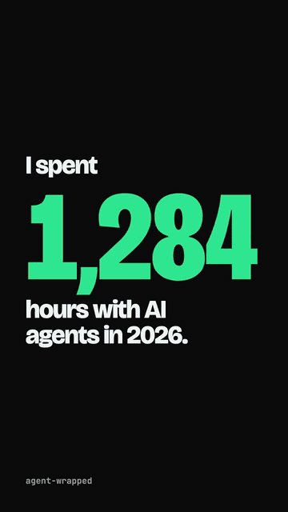](docs/demo.mp4)

## Install

```sh
npx skills add vkpdeveloper/agent-wrapped
```

Then ask your agent:

- "make my agent wrapped"
- "make a short agent wrapped I can post"
- "how many times did I swear at my agent? make the video"
- "rank my agents in a tier list"
- "show the funniest things my agent said back to me"
- "make my agent wrapped, but blur my project names"
- "make my agent wrapped across all my machines"
- `/agent-wrapped chat` in Claude Code, `$agent-wrapped roast me` in Codex

That is the whole prompt. Your agent shows you the formats with your own
numbers and recommends one, and the skill knows each format's joke and digs up
your loudest lines for it, so there is nothing to explain. The
skill downloads the right binary for your machine on first use and keeps it
updated. Works on macOS, Linux and Windows.

## Formats

| | | | | |
| :---: | :---: | :---: | :---: | :---: |
| 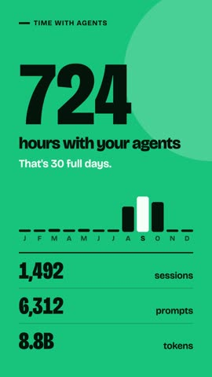<br>`full` the whole year | 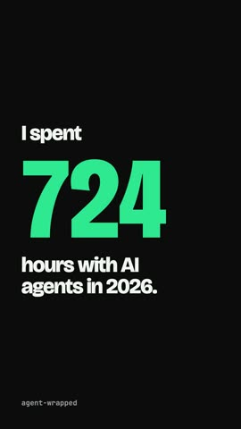<br>`social` 30s to post | 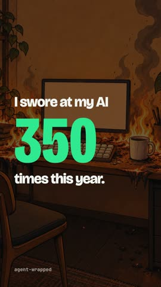<br>`rage` your swears | 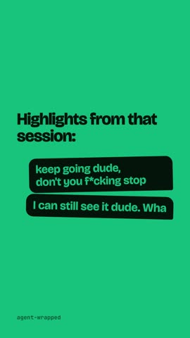<br>`loop` it would not listen | 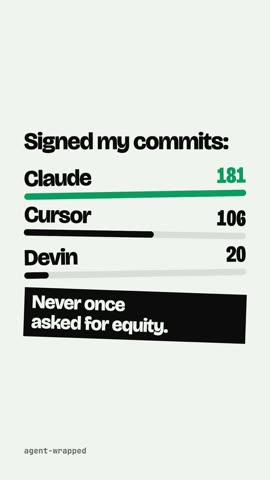<br>`credit` who signed your commits |
| <br>`grind` longest day, streak | 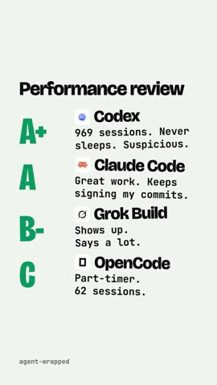<br>`boss` your agents' reviews | 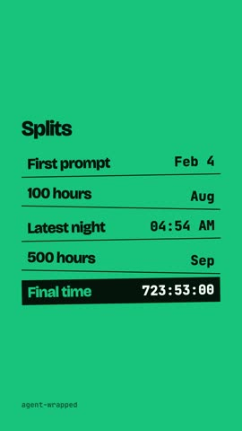<br>`speedrun` world record splits | <br>`genz` brainrot captions | 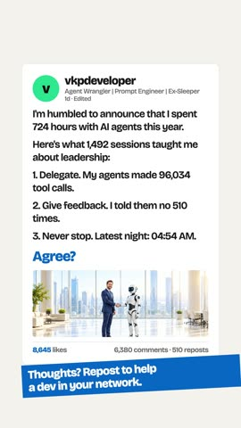<br>`linkedin` the humblebrag |
| <br>`docu` nature documentary | <br>`news` breaking news | 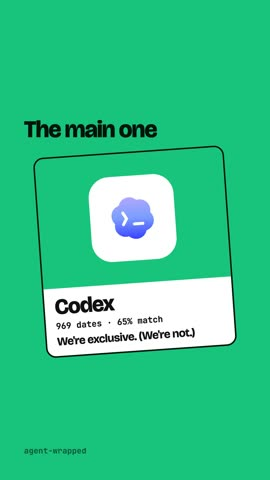<br>`dating` your agents as exes | 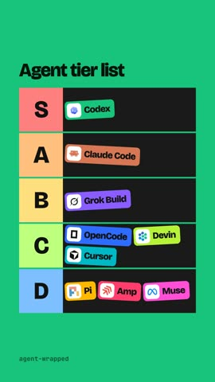<br>`tier` the tier list | 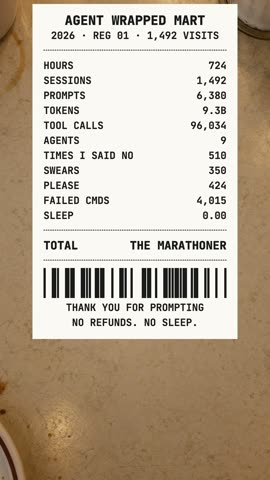<br>`receipt` the year, itemized |
| <br>`trailer` the movie | 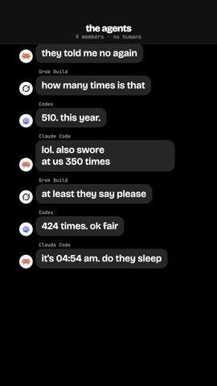<br>`chat` your agents' group chat | 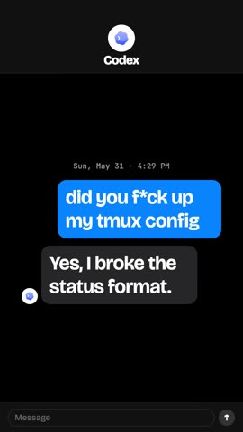<br>`convo` what it said back | | |

Every format but `full` is 13 to 30 seconds, with no projects, tools or models,
and swears censored on screen.

## What you get

- **MP4** in vertical (1080x1920) or square (1080x1080)
- **Music per format**: rage trap for rage, phonk for genz, chiptune for the speedrun, elevator bossa for the receipt, all on the beat of the cuts, with a vine boom, air horn or stamp on every hit
- **Your own words**: your agent picks the lines you typed that sound most like you, and the funniest things your agents said back, in any language (Hindi included)
- **Jokes about you**: your agent writes every format's punchlines from your own numbers, prompts and its replies, so no two videos are the same
- **Lessons and a persona**: the rules that would have saved you the trouble, and who that makes you
- **Every agent**, with its real logo: Claude Code, Codex, OpenCode, Pi, Amp, Cursor, Grok Build, and the threads T3 Code runs with them (Devin and Muse too)
- **Private**: nothing is uploaded, secrets show up as `********`, and `--blur-projects` hides project names

## CLI

```sh
curl -fsSL https://raw.githubusercontent.com/vkpdeveloper/agent-wrapped/main/skill/agent-wrapped/wrapped.sh | sh -s -- --version

agent-wrapped agents                          # agents found, most sessions first
agent-wrapped -o wrapped.mp4                  # this year, vertical
agent-wrapped --year 2025 --format square
agent-wrapped stats -o wrapped.json           # the numbers, to edit lessons, quotes or persona
agent-wrapped render wrapped.json --social    # the 30 second cut to post
agent-wrapped lines wrapped.json --cut rage   # what its jokes are written from
agent-wrapped render wrapped.json --cut rage  # any format above
agent-wrapped render wrapped.json --blur-projects
ssh laptop agent-wrapped sessions > laptop.json
agent-wrapped --add laptop.json               # another machine, duplicates counted once
```

Run `agent-wrapped --help` for everything else.

## License

MIT. Rendering uses [Remotion](https://www.remotion.dev/license), which is free
for individuals and small teams. Larger companies need a Remotion company license.
